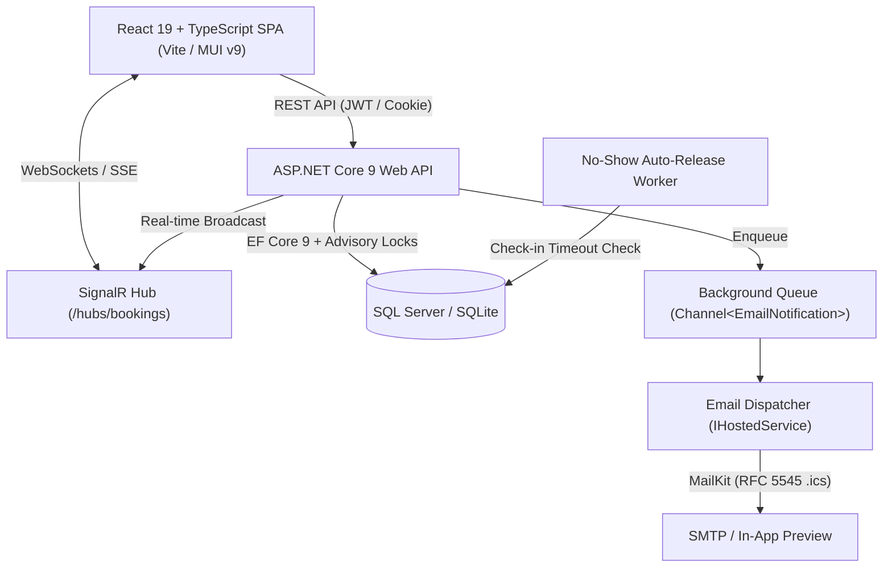

# Real-Time Meeting Room & Cabin Booking System

[](https://github.com/aryanjadhav-developer/meeting-room-booking/actions/workflows/ci.yml)
[](https://github.com/aryanjadhav-developer/meeting-room-booking/actions/workflows/codeql.yml)


[](LICENSE)

A high-concurrency, real-time meeting room reservation platform built with **ASP.NET Core 9**, **SignalR**, **Entity Framework Core**, and **React 19 + TypeScript**.

Engineered to solve real-world workplace scheduling challenges: race-condition-free reservations via database advisory locks, multi-client real-time synchronization, enterprise-grade authentication with refresh token rotation and account lockout, audit trails, and automated RFC 5545 `.ics` calendar dispatch.

---

## ⚡ Instant Live Demo

Try the live application deployed on Render (free tier):
👉 **[Launch Live Demo](https://meeting-room-booking.onrender.com)** *(Note: Free instances wake from sleep in ~30 seconds)*

| Role | Pre-Seeded E-mail | Password | Permissions |
|---|---|---|---|
| **Administrator** | `demo.admin@example.com` | `DemoAdmin123!` | Full control: room config, audit logs, settings, reports, user promotion |
| **Employee** | `alex.carter@example.com` | `DemoPass123!` | Create/edit bookings, check-in, calendar export, self-service schedule |

*The login page also provides 1-click **"Try as Admin"** and **"Try as Employee"** buttons for instant access.*

---

## 🚀 Key Engineering Highlights

### 1. Concurrency-Safe Booking (Zero Double-Bookings)
Preventing overlapping reservations in a high-traffic office is non-trivial. Standard optimistic concurrency fails when two concurrent requests insert two distinct, overlapping records.
- **Solution:** We use per-room advisory application locks (`sp_getapplock` on SQL Server, coordinated asynchronous semaphores on SQLite).
- When a booking transaction begins for `Cabin:X`, an exclusive lock is acquired for that specific room ID. The engine queries for overlapping time intervals (`newStart < existingEnd AND newEnd > existingStart`).
- If another request arrives for the same cabin at the same time, it queues safely. Exactly one request succeeds with `201 Created`; colliding requests cleanly fail with `409 Conflict`.
- Bookings for different cabins proceed concurrently without locking contention.

### 2. Multi-Client Real-Time Synchronization (SignalR)
- Connected browsers receive instant push updates over WebSockets via **ASP.NET Core SignalR**.
- When any user books, extends, checks in, or cancels a meeting, the room board and day timeline immediately re-render across all open devices without page reloads or polling.
- Reconnection resilience: The client transparently recovers state and invalidates TanStack Query caches upon network reconnect.

### 3. Dual-Provider Database Architecture (SQLite & SQL Server)
- **Zero-Setup Local Dev:** Default SQLite mode (`Database:Provider=Sqlite`) creates and seeds the database automatically on startup (`dotnet run`). Zero external tools or setup required.
- **Production Enterprise Grade:** SQL Server provider (`Database:Provider=SqlServer`) supports production deployments and Docker Compose stacks.
- **Testcontainers Integration:** Integration tests run against ephemeral SQL Server Linux containers in Docker, ensuring tests execute with 100% database engine fidelity in CI pipelines without pre-existing databases.

### 4. Enterprise Security & Authentication Upgrade
- **ASP.NET Core Identity & JWT:** Stateless access tokens paired with cryptographically secure, single-use refresh token rotation.
- **HttpOnly Secure Cookies:** Refresh tokens (`cb_refresh_token`) are transmitted via HttpOnly, SameSite, Secure cookies, shielding against XSS token harvesting.
- **Brute-Force & Lockout Protection:** 5 consecutive failed login attempts trigger an automatic 15-minute account lockout.
- **Rate Limiting:** Built-in fixed-window rate limiter on `/api/auth/*` prevents credential enumeration.
- **Security Headers:** Strict Content Security Policy (CSP), HSTS, `X-Content-Type-Options: nosniff`, and `X-Frame-Options: DENY`.

### 5. Asynchronous Calendar Invites & In-App Outbox
- **RFC 5545 iCalendar:** Every booking creation, update, and cancellation generates an `.ics` calendar invitation attachment compatible with Google Calendar, Outlook, and Apple Calendar.
- **Non-Blocking Channel Queue:** Email generation is offloaded to a background `IHostedService` via `System.Threading.Channels.Channel<T>`, keeping HTTP response latency under 30ms.
- **In-App Demo Outbox:** In development and demo environments, all dispatched emails and calendar attachments are viewable directly within the UI dialog (`/api/auth/preview-emails`).

### 6. Dynamic Administration & Audit Trails
- **Dynamic Policy Settings:** Office hours, bookable days, grace periods, and advance limits can be modified live by administrators and persist in the database, falling back to configuration defaults.
- **Immutable Audit Trail:** All administrative changes, cabin modifications, and booking actions record actor ID, client IP, action type, and diff metadata.
- **CSV Data Export:** Endpoints for exporting raw booking records and room utilization analytics to standard CSV.

---

## 🏛️ System Architecture



### Clean Architecture Layers
```
src/
├── CabinBooking.Domain/           # Core domain entities (Booking, Cabin, User, AuditEntry, SystemSetting)
├── CabinBooking.Application/      # Business services, DTOs, FluentValidation rules, ICS & CSV builders
├── CabinBooking.Infrastructure/   # AppDbContext, SQLite/SQL Server locks, MailKit email, Migrations
└── CabinBooking.Api/              # Controllers, SignalR hubs, Background hosted workers, Serilog, Swagger
client/                            # React 19 SPA, TypeScript, Vite, TanStack Query, MUI v9
tests/
├── CabinBooking.UnitTests/        # 28 fast isolated business logic & rule validator unit tests
└── CabinBooking.IntegrationTests/ # 112 full-stack API, concurrency, security, and feature tests (Testcontainers)
```

---

## 💻 Quick Start

### Option A: Instant Run (Zero Setup, SQLite)
Requires [.NET 9 SDK](https://dotnet.microsoft.com/download/dotnet/9.0) and [Node.js 22+](https://nodejs.org/).

```bash
# 1. Clone repository
git clone https://github.com/aryanjadhav-developer/meeting-room-booking.git
cd meeting-room-booking

# 2. Run backend (automatically creates and seeds local CabinBooking.db)
dotnet run --project src/CabinBooking.Api

# 3. In another terminal, start client
cd client
npm install
npm run dev
```
Open **`http://localhost:5173`** in your browser.

---

### Option B: Docker Compose (Full Stack with SQL Server & Mailpit)
Requires [Docker Desktop](https://www.docker.com/).

```bash
docker compose up --build
```
- Web Application & API: `http://localhost:8080`
- Swagger Documentation: `http://localhost:8080/swagger`
- Mailpit Web Interface: `http://localhost:8025`

---

## 🧪 Automated Testing & Quality Metrics

The codebase maintains **140 automated tests** passing with 100% green status across unit, integration, and security suites:

```bash
# Run all backend unit & integration tests
dotnet test

# Run frontend unit tests (Vitest)
cd client && npm test

# Run code coverage collection
dotnet test --collect:"XPlat Code Coverage"
```

| Test Suite | Count | Focus Areas |
|---|---|---|
| **CabinBooking.UnitTests** | 28 | Time zone calculations, duration clamping, overlap logic, business policy validator |
| **CabinBooking.IntegrationTests** | 112 | Concurrency race conditions (`sp_getapplock`), refresh token rotation, account lockout, rate limiting, audit logging, settings persistence, CSV exports, Testcontainers |
| **Client Vitest Suite** | 19 | UI time math, duration formatters, booking phase calculation, permissions |

---

## 📖 Architecture Decision Records (ADRs)

Key architectural decisions are documented in [`docs/adr/`](docs/adr/):
- [ADR 0001: SQL Application Locks for Concurrency Control](docs/adr/0001-sql-app-lock-concurrency.md)
- [ADR 0002: Direct EF Core Usage vs Generic Repository Pattern](docs/adr/0002-direct-ef-core-vs-repository.md)
- [ADR 0003: SignalR Realtime Architecture for Multi-Client Synchronization](docs/adr/0003-signalr-realtime-architecture.md)
- [ADR 0004: Dual-Provider Database Architecture (SQLite & SQL Server)](docs/adr/0004-sqlite-for-demo-and-zero-setup.md)
- [ADR 0005: Refresh Token Rotation, Secure Cookies, and Account Lockout](docs/adr/0005-refresh-token-rotation-and-lockout.md)

---

## 📄 License

This project is licensed under the [MIT License](LICENSE).
