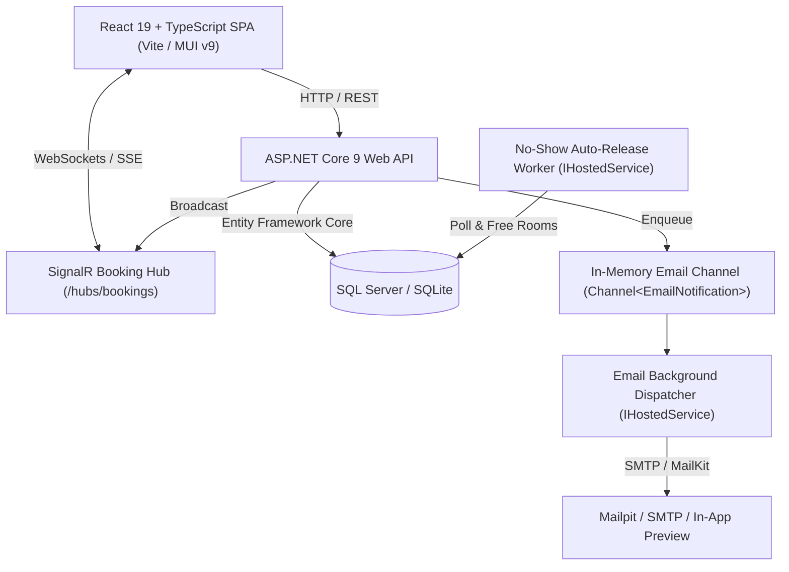

# Architecture & Design Overview

## 1. System Topology

## 2. Layer Separation (Clean Architecture)

- **Domain (`CabinBooking.Domain`):** Core entities (`Booking`, `Cabin`, `User`, `AuditEntry`, `SystemSetting`) and enums (`BookingStatus`, `BookingPhase`, `BookingPurpose`, `UserRole`). Has zero dependencies on EF Core or web frameworks.
- **Application (`CabinBooking.Application`):** Business logic services, DTOs, interfaces, and FluentValidation validators. Coordinates business transactions, policy rules, and audit logging.
- **Infrastructure (`CabinBooking.Infrastructure`):** Database context (`AppDbContext`), multi-provider migrations, database locks (`SqlAppCabinLock`, `SqliteCabinLock`), audit logger, email delivery, and seeders.
- **API (`CabinBooking.Api`):** HTTP Controllers, SignalR Hubs, background hosted services, JWT authentication, rate limiting, and Serilog structured logging.

## 3. Key Concurrency & Integrity Mechanisms

1. **Advisory Locking (`sp_getapplock`):** Serializes booking transactions per room without coarse table locking.
2. **Channel-Based Background Processing:** Decouples email delivery and calendar invite generation from HTTP request threads using `System.Threading.Channels.Channel<T>`.
3. **Optimistic & Soft Lock Resiliency:** Immediate feedback via SignalR events prevents users from initiating overlapping booking forms.
